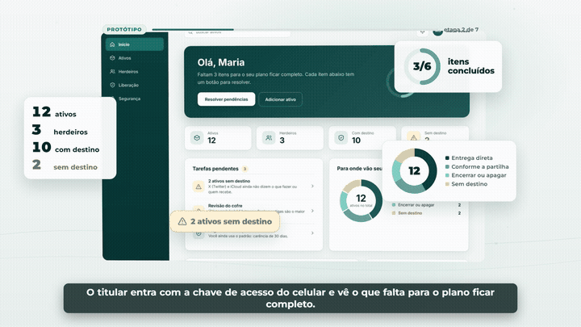
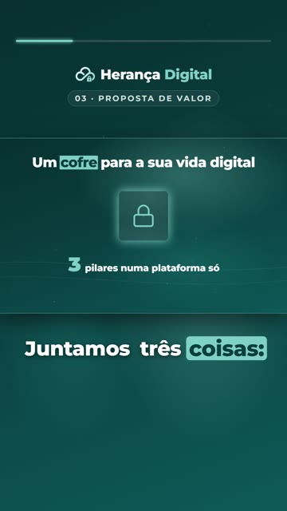

# Herança Digital — pitch em vídeo feito com código


Pitch de **3 minutos** da **Herança Digital** — um cofre para a vida digital: inventário de contas e ativos,
acessos criptografados e um plano de liberação para os herdeiros. Projeto da squad **EternaByte**
(UC HUB · Sprint 2).

O vídeo inteiro é **programado em React** com [Remotion](https://www.remotion.dev/): cada cena é um componente,
cada animação é calculada quadro a quadro e tudo se sincroniza com a narração.

<p>
  
  
</p>

**Destaques**

- **Dois formatos do mesmo projeto:** horizontal 16:9 (1920×1080) e em pé 9:16 para TikTok/Reels/Shorts, com legendas grandes palavra a palavra.
- **Sincronia automática com a voz:** a narração gera os tempos de cada palavra; cenas, legendas, efeitos e trilha se reposicionam sozinhos.
- **Estúdio de Revisão próprio** (Vite + `@remotion/player`): editar textos, tempos e volumes e deixar *pins* de revisão no quadro exato, com foto.
- **Trilha gerada por script** (Python) no andamento do vídeo, com mixagem e normalização a −14 LUFS.
- **Dados validados** por schema Zod e auditorias automáticas (duração, legendas, níveis de áudio).

**Stack:** TypeScript · React 19 · Remotion 4 · Vite · Zod · Python · FFmpeg

---

## Guia do projeto

1920×1080, 30 fps, H.264, ≤ 3 min. Tudo é editável num arquivo só — `src/data/project.json`, validado por um
schema Zod — e o editor local (`npm run editor`) serve para ajustar textos, tempos e áudio e **deixar comentários
no quadro exato**, que depois o Claude Code resolve.

## Começar

```bash
cd video
npm install
npm run editor            # editor do HORIZONTAL (16:9) → http://localhost:5174
npm run editor:vertical   # editor da versão EM PÉ (9:16, TikTok/Reels) → http://localhost:5175
```

### Dois vídeos, dois editores (independentes)

| | Horizontal 16:9 | Em pé 9:16 (TikTok/Reels/Shorts) |
|---|---|---|
| Editor | `npm run editor` (:5174) | `npm run editor:vertical` (:5175) |
| Projeto | `src/data/project.json` | `src/data/project-vertical.json` |
| Revisões (pins) | `revisoes/` · `npm run revisoes` | `revisoes/vertical/` · `npm run revisoes:vertical` |
| Trilha | `public/audio/trilha.wav` | `public/audio/trilha-vertical.wav` |
| Render | `npm run render` → `out/pitch-v2.mp4` | `npm run render:vertical` → `out/pitch-vertical.mp4` |

Editar um **não muda o outro** (textos, durações, legendas, efeitos, cores, volumes, pins). Os dois podem ficar
abertos ao mesmo tempo. O que é **comum** aos dois: a narração (`narracao.ts`, a voz gravada/sintética) e as
animações (código das cenas). Quando a voz muda, `npm run sync` atualiza os dois projetos preservando as edições
manuais de cada um. Ao pedir correção ao Claude, diga de qual vídeo é o pin (o editor em pé mostra "Em pé 9:16"
no título). `npm run stills:vertical -- --quadros=300,2400` tira fotos da versão em pé.

Outros comandos:

```bash
npm run dev            # Remotion Studio (painel de props editável, com botão de salvar)
npm run render         # confere placeholders e gera os arquivos finais (≈ 20–30 min)
npm run render:draft   # rascunho rápido, sem travar nos placeholders
npm run check          # lista o que ainda está [PREENCHER]
npm run validar        # valida o project.json com o schema
npm run revisoes       # lista as revisões abertas (pins do editor)
npm run stills         # 2 quadros por cena em out/stills-v2/
npm run audit          # auditoria: movimento, áudio, legendas, duração → out/auditoria.json
```

Saídas: `out/pitch-v2.mp4` (com voz) · `out/pitch-v2-musica-e-sfx.mp4` (sem voz) · `out/audio-mix.wav` ·
`out/rascunho-540p.mp4` (botão "Rascunho" do editor).

Tudo roda **na sua máquina**: sem login, sem nuvem, sem telemetria, sem serviço pago.

## Ciclo de trabalho

1. `npm run editor` e assista ao vídeo.
2. **Texto, duração, cores, volume, legenda, efeito sonoro** → mude você mesmo no editor. Salva sozinho em
   `project.json` (e o Ctrl+S força). O preview muda na hora; `npm run render` usa o mesmo arquivo.
3. **Animação, movimento, estrutura, coisa que o editor não alcança** → pare no quadro, aperte **C**, clique no
   ponto do vídeo (opcional) e escreva o que está errado e o que você quer. O editor guarda o comentário em
   `revisoes/revisoes.json` com a foto do quadro em `revisoes/pins/<id>.png`.
4. Quando juntar alguns pins, diga ao Claude Code: **"resolva as revisões abertas"**
   (ou clique em *Copiar pedido para o Claude Code* na aba Revisões e cole).
   O Claude lê cada pin e a foto, corrige, confere e marca como **feito** — o pin fica verde no editor.
5. Renderize: botão **Final 1080p** no editor ou `npm run render`.

## Como reportar um erro

Pelo editor é só apertar **C**. Se for por mensagem, use este modelo (uma linha por problema):

```
Cena/tempo:   Cena 5 · 01:21.5   (ou o quadro: 2444)
O que está errado:  o card do herdeiro corta o texto "carência"
O que eu quero:     texto em duas linhas, sem cortar
(print):            anexe a captura de tela, se tiver
```

## O Estúdio de Revisão (`npm run editor`)

| Área | O que faz |
|---|---|
| **Centro** | Player com play/pausa, ±1 quadro, ±1 s, volume, repetir a cena, velocidade 0,25–2×, tempo + quadro, grade da margem de segurança (80 px). |
| **Esquerda** | Cenas com miniatura (clique = vai para a cena e abre no inspetor), *Projeto* (equipe, marca, cores) e *Áudio*. |
| **Direita · Inspetor** | Edita o que estiver selecionado: textos da cena (`*palavra*` = destaque), duração, fundos, tela/recorte do protótipo; legenda; efeito sonoro (som, volume, quadro, ouvir); níveis de voz/trilha/efeitos; equipe e cores. |
| **Direita · Revisões** | Pins com foto, filtros, caixa "feito", apagar, *Copiar pedido para o Claude Code*. |
| **Embaixo · Timeline** | Régua, linhas da batida, cabeça arrastável, Ctrl+roda = zoom. Faixas Cenas / Legendas / Voz (onda) / SFX / Trilha (onda + ducking) / Comentários, com mudo (M) e solo (S). |

- **Duração de cena**: arraste a borda direita do bloco. Encaixa na batida (16 q); **Shift** = livre.
  Nunca passa de 180 s e nunca fica menor que a fala da cena. A cena arrastada fica "travada" (o `npm run sync` respeita).
- **Legenda**: arraste para mover, puxe as pontas para ajustar; editar o texto redistribui as palavras.
- **Efeito sonoro**: arraste o losango; no inspetor troque o som, o volume ou crie um novo na posição da cabeça.
- **Mudo/solo** só valem para o preview, não mudam o vídeo final.
- **Validação ao vivo**: se o projeto ficar inválido (mais de 180 s, texto vazio, tela inexistente) o editor mostra
  o erro em vermelho e **não salva** até corrigir.
- **Desfazer/refazer** sem limite durante a sessão; cada salvamento guarda uma cópia em `revisoes/historico/`
  (as 50 últimas) — para voltar a uma versão antiga, copie o arquivo por cima de `src/data/project.json`.
- Miniaturas, fotos dos pins e stills são feitos por um processo à parte (`scripts/editor-still-worker.mjs`),
  um por vez e com cache de webpack próprio: dá para rodar `npm run render`/`npm run stills` com o editor aberto.
  Se esse processo cair, o editor continua no ar, sobe outro e tenta o pedido de novo.
- O selo amarelo **⚠ N campos [PREENCHER]** mostra quantos placeholders faltam (clique para abrir a equipe).

### Atalhos

| Tecla | Ação |
|---|---|
| Espaço | play / pausa |
| ← / → | −1 / +1 quadro |
| Shift + ← / → | −1 / +1 segundo |
| J / K / L | volta 1 s / pausa / play (L de novo acelera) |
| C | comentar o quadro atual (pin) |
| M | mudo |
| Ctrl+Z / Ctrl+Shift+Z | desfazer / refazer |
| Ctrl+S | salvar agora |
| S | não divide cena (cada cena é uma animação própria) — mostra um aviso |

### O que o editor **não** faz (de propósito)

Não muda **animação, movimento, ordem das cenas nem efeitos visuais**: isso é código (`src/cenas/S*.tsx`). O editor
mostra "Animação: peça ao Claude" — deixe um pin. Também não grava voz (veja abaixo) nem troca a trilha.

## Remotion Studio (`npm run dev`)

O schema Zod está registrado na composição, então o painel **Props** do Studio mostra os campos do projeto com
preview ao vivo e botão de salvar. Como o Studio só consegue salvar quando as props estão escritas no próprio arquivo
da composição, `npm run dev` gera `src/studio/Composicao.gerada.tsx` a partir do `project.json` e fica observando:
o que for salvo no Studio é validado e copiado de volta para o `project.json`. **Não edite o `.gerada.tsx` à mão.**

## Voz (o vídeo inteiro se ajusta a ela)

O texto da narração está em **`src/data/narracao.ts`** (uma frase por `id`). A timeline é **guiada pelo áudio**:
cada cena dura o que as frases dela duram (+ respiros na grade da batida), e as animações estão presas às
**palavras** (ex.: o cofre congela quando a voz diz "congelado").

**A) Voz do grupo (recomendado).** Siga **`docs/ROTEIRO_GRAVACAO.md`**. Salve cada frase como
`video/gravacoes/<id>.m4a|wav|mp3` (ex.: `s01_01.m4a`) e rode:
```bash
npm run voz:importar   # corta silêncio, normaliza, alinha palavra a palavra (whisper) e refaz o project.json
npm run render
```
**B) Voz sintética** (está no vídeo agora): **Thalita** (`pt-BR-ThalitaMultilingualNeural`, edge-tts), feminina,
velocidade natural, **sem edição nenhuma** — ⚠ **provisória, aguardando um motor melhor** (revisão "voz natural").

- **Revertido:** a versão "expressiva" (emendas de palavras com tom/velocidade/volume por trecho) soou robótica e
  saiu — guardada em `backup/voz-expressiva/` só para referência (`expressividade: 0` em `src/data/voz.ts`).
- **Motores melhores precisam de chave** (nenhuma existe nesta máquina): ElevenLabs (`ELEVENLABS_API_KEY`),
  OpenAI `gpt-4o-mini-tts` (`OPENAI_API_KEY`) ou Google Chirp 3 HD (conta de serviço em
  `GOOGLE_APPLICATION_CREDENTIALS`). Com uma delas definida como variável de ambiente, dá para gerar o banco de
  testes com esses motores e escolher de ouvido.
- **Escolher outra voz:** `out/voz-teste/vozes.html` (as mesmas 3 frases em 8 vozes); mude
  `VOZ_ESCOLHIDA` em `src/data/voz.ts` (re-exportada em `config.ts`). Depois: `npm run voz` (regenera a narração
  inteira e roda o sync: timeline, legendas, efeitos e trilha). `npm run voz:teste` refaz o banco de testes.
- **Motores que rodam aqui:** edge-tts (Thalita, Francisca, Ava e Emma multilíngues) e **Kokoro** local (Dora,
  `pf_dora`; o tempo de cada palavra vem do whisper). **Sem chave nesta máquina:** ElevenLabs, OpenAI TTS e
  Google Chirp 3 HD — com uma chave dá para acrescentar. O edge-tts não aceita SSML próprio nem estilos de emoção.
- **Sem aceleração:** a velocidade é a natural da voz (no máximo ±3 %). Se passar de 180 s, o `npm run voz` para
  e pede para enxugar o texto — ele não acelera mais a voz.
- **Tratamento mínimo:** só corte do silêncio nas duas pontas, fade de 20 ms e normalização (−16 LUFS). Sem compressão, EQ, de-esser nem reverb;
  pausa real entre frases ≈ 0,35–0,4 s. `npm run voz:conferir` confere duração, sample rate, LUFS, pico e
  silêncios dentro das frases.
- **Texto enxugado para caber em 180 s na velocidade natural** (só conectivos, nenhum fato): s03_03, s06_04
  ("E…" e "com o botão" saíram), s08_02, s09_01 e s09_02.

Depois de mudar texto/voz: `npm run sync`. O sync **preserva** o que foi editado à mão no editor (textos da tela,
fundos, telas, durações travadas, legendas e efeitos marcados como manuais).

## Trilha e efeitos

- **Trilha**: `scripts/make_music.py` gera `public/audio/trilha.wav` (112,5 BPM, arco de energia por cena).
  Para usar uma trilha livre de direitos do grupo, substitua o arquivo e não rode o `make_music.py`.
- **Efeitos**: `npm run sfx` gera 15 sons sintetizados em `public/audio/sfx/`.
- **Mixagem**: voz −16 LUFS; trilha −26 LUFS com ducking sob a voz; SFX −11 a −22 dB; final loudnorm −14 LUFS.
  Os níveis ficam em `project.json → audio` (editáveis no editor, aba *Áudio*).

## O que preencher (aparece em AMARELO no vídeo)

No editor, item **Projeto**: nome do grupo, membros (nome + função), contato e o logo (`public/brand/` +
campo do logo). `npm run check` lista o que falta. Depois de mudar o nome do grupo com voz sintética, rode
`npm run voz:sintetica` (a voz pula o nome enquanto for placeholder).

## Logos de plataformas

Logos são marcas de seus respectivos donos, usadas apenas para identificar as plataformas. Sem parceria nem apoio.

Arquivos em `public/brand/marcas/svg` (PNG em `png/` como reserva), mapeados em `src/data/marcas.ts` e desenhados
por `src/components/BrandLogo.tsx` (props `nome`, `tamanho`, `glow`): cores originais, sem deformar, X e Apple na
versão branca no fundo escuro, Netflix dentro de um quadrado arredondado. Domínio, banco digital e Ledger não têm
logo e usam ícone genérico. Onde aparecem: S1 (perguntas e órbita), S2 (grade, órbita e cobranças), S5 (caixinha
do X no inventário) e S7 (acima dos cabeçalhos).

## Estrutura

```
src/data/project.json     FONTE ÚNICA do vídeo (editada pelo editor, pelo Studio e pelo npm run sync)
src/data/schema.ts        schema Zod (limites, telas, falas dentro da cena…)
src/data/projeto.ts       leitura do projeto + tempos absolutos (derivado)
src/cenas/                S1Abertura … S9Fechamento (animação; textos/fundos/telas vêm do projeto)
src/components/fx, v2     biblioteca de movimento, fundo, legendas, transições, mixagem
src/studio/               composição gerada para o Studio (não editar)
editor/                   Estúdio de Revisão (Vite + React + @remotion/player) e API local (api.ts)
revisoes/                 revisoes.json · pins/<id>.png · historico/ · auto-revisao.md
scripts/                  sync, render-final, render-stills, gerar-studio, validar-projeto, revisoes, áudio…
docs/                     RECEITA_DE_MOVIMENTO · ROTEIRO_GRAVACAO · PROGRESSO_V2 · PROGRESSO_V3
```

## Decisões

- **BPM 112,5** (16 q/batida) em vez de 120: é o medido na referência e dá número inteiro de quadros. O
  "encaixe na batida" do editor usa esses 16 q.
- Cortes de cena na **meia batida** (8 q).
- **Dividir cena (S)** não existe: cada cena é uma animação escrita à mão, então dividir é trabalho de código → pin.
- O editor salva sozinho 0,8 s depois de cada mudança válida (mais simples que lembrar de salvar);
  o histórico em `revisoes/historico/` cobre o "voltar atrás".
- O **rascunho 540p** do editor renderiza o que está no editor (mesmo sem salvar); o **final** salva antes.
- Texto só com espaços conta como vazio (inválido).
- **Abertura (revisão #1)**: a revisão pedia "120 BPM, 1 batida = 15 q", mas a trilha e todos os cortes estão em
  112,5 BPM (16 q). Mantive 16 q para os cadeados (1 a cada meia batida = 8 q) não saírem do tempo da música.
- A S1 tem 12,3 s (368 q, limite pedido 12,5 s): o clímax começa no fim de "criptomoedas" e a pausa antes de
  "Somos…" é fixa em `narracao.ts` (`pausa: 42`). Mudar a voz da S1 pode pedir outro valor (os cadeados se
  comprimem para caber, mas ficam mais juntos).
- `npm run voz:sintetica -- --so=s1` gera a voz sintética só das frases da S1 (ou de ids: `--so=s01_02,s01_03`).
- Legenda editada à mão volta a ser gerada se o texto da fala dela mudar (o sync avisa no terminal).
- Ícones da abertura são genéricos, concorrência é **conceitual**, parcerias são sempre **"previstas"** e os nomes
  nas telas são fictícios (PROMPT.md §2).
